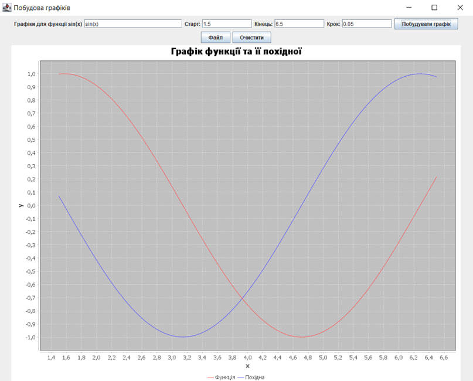
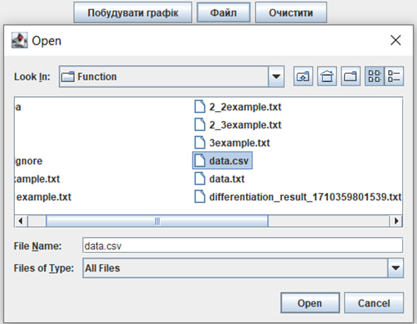
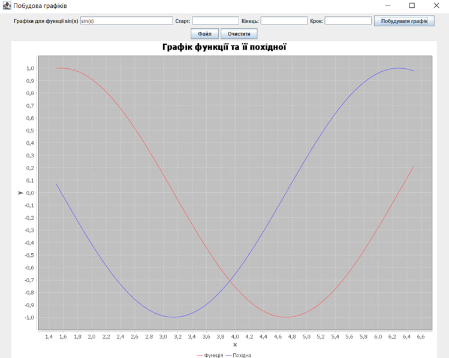
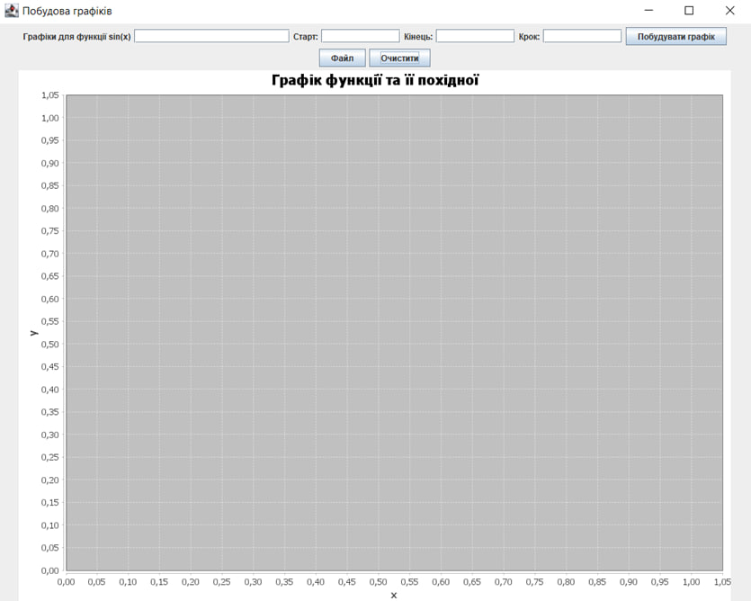
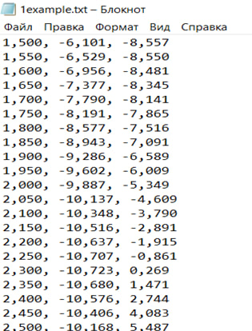
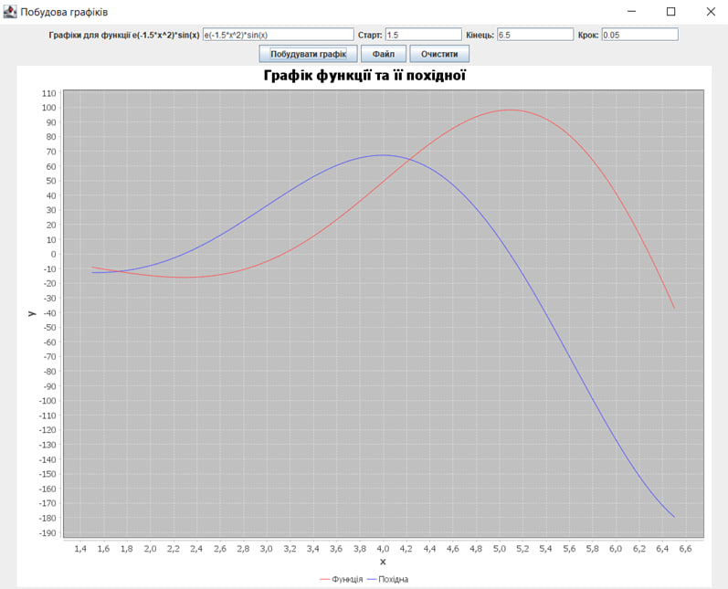

# Function & Derivative Plotter (Java Swing)

A desktop application written in Java that plots a mathematical function together with its numerical derivative. The function is typed in as a string, evaluated at run time, and both curves are drawn on one interactive chart. Results are also saved to a text file.

The project was developed as a university assignment (Cross-Platform Programming course, V. N. Karazin Kharkiv National University) and covers GUI development, file I/O, collections, numerical methods, refactoring and re-engineering.

---

## Features

- **Analytical input**: type any function of `x`, for example `exp(-x^2)*sin(x)`, and set the start, end and step of the interval.
- **Numerical differentiation**: the derivative is computed with the central difference scheme.
- **Interactive charts**: the function and its derivative are shown on one JFreeChart plot (zoom and pan supported).
- **File input**: load a list of `x` values from a CSV file and plot the function over those points.
- **Automatic export**: every calculation is saved to a timestamped text file in the format `x, f(x), f'(x)`.
- **Clear button**: resets all input fields, the chart and the loaded data in one click.
- **Input validation**: empty fields, invalid numbers and unreadable files are reported through dialog windows.

---

## Screenshots

<!-- Figure 1.5.2 -->
<p align="center">
  
</p>

---

## How it works

### Numerical derivative

The derivative is approximated with the central difference formula:

```
f'(x) ≈ ( f(x + h) - f(x - h) ) / (2h)
```

where `h` is the step entered by the user (or the distance between the first two `x` values when data is loaded from a file).

### Expression parsing

The function string is parsed and evaluated by [mXparser](https://mathparser.org/), so common operations and functions (`sin`, `cos`, `exp`, `^`, and so on) work out of the box.

### Plotting

Both series are put into an `XYSeriesCollection` and rendered by [JFreeChart](https://www.jfree.org/jfreechart/) inside a `ChartPanel` embedded in the Swing window.

### File handling

- **Reading**: `BufferedReader` and `FileReader` read comma-separated numeric values into an `ArrayList<Double>`. Quotes and whitespace are stripped, and invalid entries are reported.
- **Writing**: `FileWriter` saves results to `differentiation_result_<timestamp>.txt`, one line per point, formatted to three decimal places.

---

## Tech stack

| Area | Technology |
|---|---|
| Language | Java |
| GUI | Swing (`JFrame`, `JPanel`, `JTextField`, `JButton`, `JFileChooser`) |
| Charts | JFreeChart |
| Expression parser | mXparser |
| Collections | `ArrayList` |
| I/O | `BufferedReader`, `FileReader`, `FileWriter` |

---

## Usage

### Analytical function

1. Enter a function, for example `exp(-x^2)*sin(x)`.
2. Fill in **Start**, **End** and **Step** (for example `1.5`, `6.5`, `0.05`).
3. Click **Build graph**.
4. The plot appears in the window and a result file is written to the working directory.

### Values from a file

1. Click **File** and choose a CSV file with `x` values, for example `1.5, 1.55, 1.6, ...`.
2. Enter the function in the function field.
3. Click **Build graph**.

Select CSV file via the "File" button 
<p align="center">
  
</p>

Graph for sin(x) based on data from the file
<p align="center">
  
</p>

### Reset

Click **Clear** to empty the fields, remove the chart and drop the loaded data.

<p align="center">
  
</p>

### Output format

```
1.500, 0.021, -0.206
1.550, 0.011, -0.185
...
```

Each line contains `x`, `f(x)` and `f'(x)`.

Saved file with x, y, and derivative values
<p align="center">
  
</p>

### Example test cases

| Function | Interval | Step |
|---|---|---|
| `exp(-x^2)*sin(x)` | [1.5, 6.5] | 0.05 |
| `exp(-a*x^2)*sin(x)` with `a = 0.5, 1.0, 1.5` | [1.5, 6.5] | 0.05 |
| `sin(x)` with `x` values from a CSV file | file-defined | file-defined |

<p align="center">
  
</p>

---

## What this project demonstrates

- Building a desktop GUI with Swing and event listeners
- Integrating third-party libraries (JFreeChart, mXparser)
- Reading and writing files with exception handling
- Working with collections (`ArrayList`)
- Implementing a numerical method (central difference) from a formula
- Validating user input and giving clear feedback
- Refactoring and extending an existing code base

---

## Known limitations and ideas for improvement

- Everything lives in one class; splitting it into model, view and controller classes would make it easier to test and extend.
- The derivative step is taken from the first two `x` values in file mode, so the file is expected to have evenly spaced points.
- The function string is re-parsed for every evaluation; caching the parsed expression would speed up large intervals.
- Add unit tests for the differentiation and file-parsing logic.
- Add a Maven or Gradle build to manage dependencies.

---

## 👨‍💻 Author

**Vladyslav Petryk**
[GitHub](https://github.com/PetrykVladyslav)
